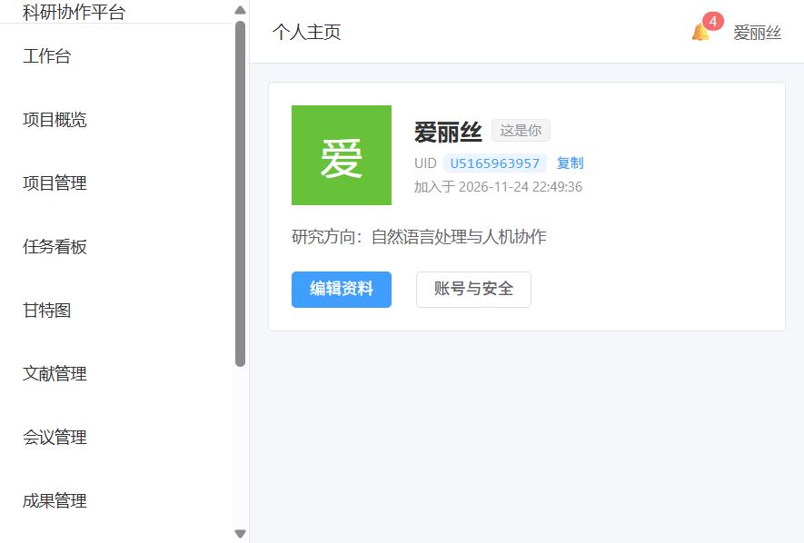
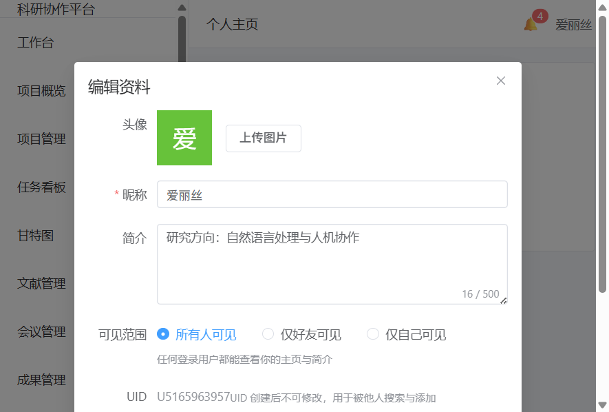
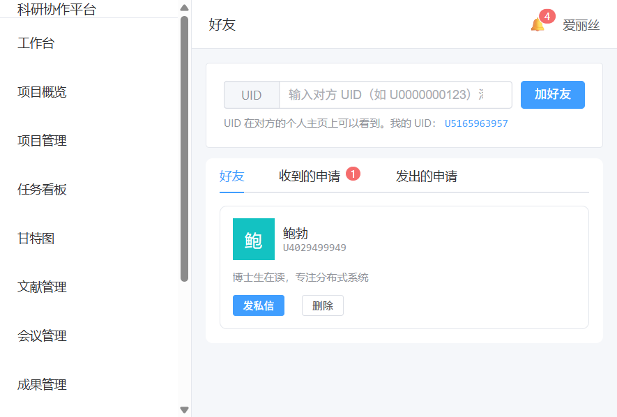
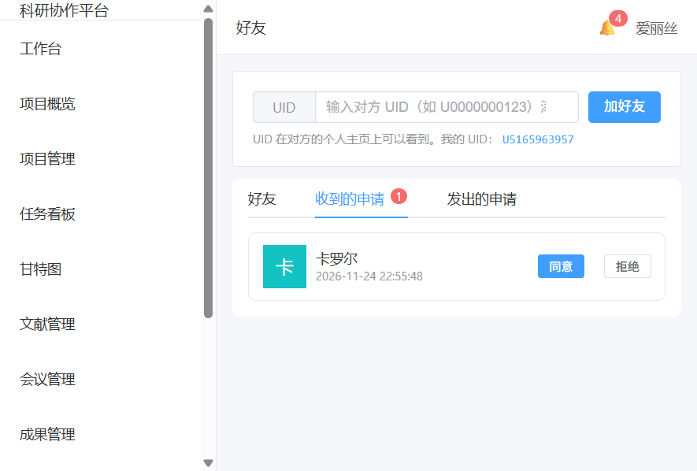
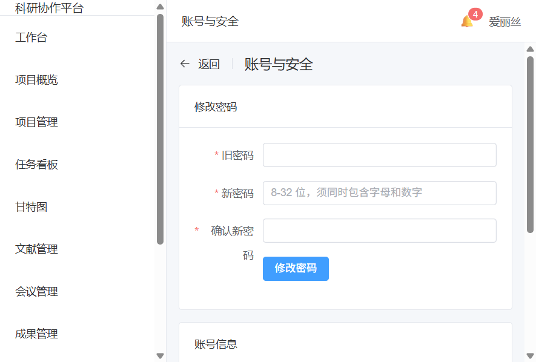
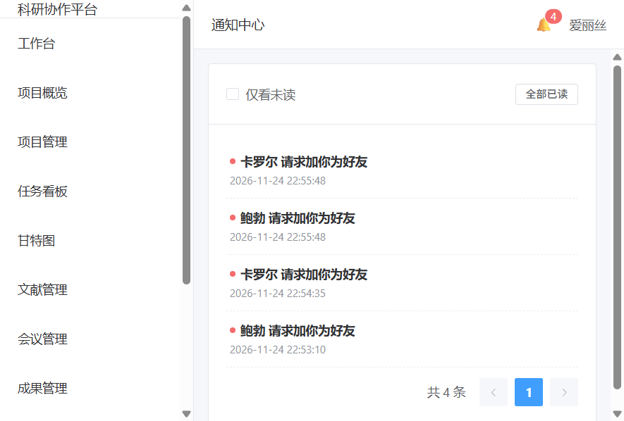

# 线③ 开发留痕（E-3 个人主页 + 好友 / F-1 会议讨论区 / T-1c / T-2）

编写时间：2026-11-23；**2026-11-24 按组长评审意见修订**；
**2026-11-27 补齐 F-1 / T-1c / T-2 三张卡（第十一节）**。
负责人：原 B 线同学（现线③ 沟通线）。

本文按 `docs/08` 第六节「给 AI 的执行须知」中「工作留痕」的要求编写，记录
**本次开发中 AI 辅助承担了哪些工作、关键决策与备选方案、需要组员复核什么**，供 PR 评审与答辩时复述。

> 总体说明：本次线③ 交付由本人主导设计与验收。AI 作为辅助工具参与了接口草案、样板代码生成、
> 缺陷排查与文档整理；**任务拆分、方案取舍、接口口径的最终决策与验收责任，均由本人确定并承担**。

> **2026-11-24 修订说明**：组长对 PR #44 提出 `CHANGES_REQUESTED`，
> 列出 A/B/C/D/E/F 六类共 18 项问题。本文逐条响应——
> 被采纳并已实现的改动写进「决策记录」与「评审响应」两节；
> 被修正的口径（尤其是「谁在什么时候拍板」）也在文中更正。
> 决策权归属以**组长/牵头人确认为准**，本文原先「用户 2026-11-23 拍板」的措辞已更正。

> **2026-11-27 补齐说明**：PR #44 合入 develop 后，线③ 整体仍有 3 张卡没做
> （T-1c / F-1 / T-2），因此被问「意思是还没做完」。
> 这三张卡已在 `feature/line3-finish` 分支补齐，**第十一节**记录了交付范围、
> 关键决策（尤其「会议结束后能看不能发」这条只读口径）与实测数字。

---

## 一、交付范围

| 卡片 | 交付内容 | 状态 |
| --- | --- | --- |
| **E-3**（扩展） | 个人主页（头像/昵称/UID/简介/可见范围 + 改密页） | ✅ 本分支 |
| **E-3** | 好友关系（申请/同意/拒绝/删除）+ 好友列表页 + 申请列表页 | ✅ 本分支 |
| **E-3** | 私信入口打通（按 UID 打开会话）+ 私信权限口径调整 | ✅ 本分支 |
| **F-1** | 会议文字讨论区 + 会议结束后只读（**2026-11-27 补齐**） | ✅ `feature/line3-finish` |
| **T-1c** | 真库集成用例 13 例，覆盖卡面四条（**2026-11-27 补齐**） | ✅ `feature/line3-finish` |
| **T-2** | Vitest 样板 + 36 项用例 + CDP 黄金路径（**2026-11-27 补齐**） | ✅ `feature/line3-finish` |
| **文件消息** | `message.file_id` + 两段式上传 + 附件卡片（**T-1c 卡面第 4 条的前置**） | ✅ `feature/line3-finish` |

**未包含**（属于本线的其他卡片，尚未开工）：

- **社区帖子详情的「私信 TA」入口**（E-1 的按钮跳 E-3 的入口）待线② 落地后接通。

---

## 二、关键决策记录

### 决策 1：私信的权限边界（推翻了原实现）

**原实现**：`ensurePrivateConversation` 要求**双方必须在同一课题组**，否则 403。

**问题**：这跟本卡的核心链路直接冲突——好友关系是**跨组**的，
「通过 UID 加好友 → 私信」如果强制同组，加好友这个功能就没有意义了。

**讨论后的口径**（**2026-11-24 牵头人确认**，见 `docs/12` 决策点 3）：

| 场景 | 口径 |
| --- | --- |
| 谁能给谁发私信 | **任何登录用户**都可以给任何其他登录用户发，不再要求同组 |
| 非好友能发几条 | **每个方向最多 1 条**（首次打招呼模式） |
| 同组的人 | **不受限**（双方在任一课题组内即解除限制） |
| 成为好友后 | **解除限制**，可自由交流 |

理由：完全放开会让陌生人刷屏骚扰；完全禁止又让加好友失去意义。
「限发 1 条 + 好友解锁」是两者的折中——想继续聊就得先成为好友，
这一步正是本卡想引导的行为。

**「同组豁免」是必须的，不是可选的**（组长评审缺陷 A2）：
`friendship` 是本卡**新增**的表，部署前就存在的私信会话里双方都不是好友。
若只按「是否好友」判定，部署后只要任一方之前发过消息，
那个会话就会被**永久冻结**（发第二条即 403），而用户没有别的入口——
这是上线即炸的缺陷。真实复现：同组两人、部署前互发过 3 条消息的会话，
部署后发送返回 403，点「私信」按钮重新打开拿到的还是同一个会话。
所以豁免条件是「**同组或好友都不受限**」。

**影响面**：`docs/01` 的私信口径、`conversations.service.ts` 的
`ensurePrivateConversation` 与 `assertMessageAllowed`、
`docs/12` 决策点 3（已回填，标注 2026-11-24 牵头人确认）。

### 决策 2：UID 用独立字段，不用 username

**选项**：
1. 新增 `public_uid` 独立字段（U + 10 位数字）；
2. 直接用现有 `username` 当 UID；
3. 用自增主键 id 字符串化。

**选了 1**，理由：
- `username` 是**登录名**，用户可能不想让它被展示给别人（很多平台两者分离）；
- 自增 id 可枚举，等于把「谁是谁」完全暴露，且可被遍历爬取；
- 独立字段还能**随时改展示样式**而不动登录逻辑。

**UID 不可修改**（用户明确要求）：防伪造、防旧搜索链接失效。
代价是用户不能自定义 UID，但换取稳定性是值得的。

**唯一性兜底**：`uk_user_public_uid` 唯一索引 + 应用层生成时冲突重试。

**存量用户的 UID 不由迁移脚本回填**（组长评审意见 C2①，原方案已废弃）：
早期版本用 `CONCAT('U', LPAD(id, 10, '0'))` 回填，理由是「id 唯一故必然唯一」。
但这**与引入 UID 的理由自相矛盾**——UID 的全部意义就是「自增 id 可枚举、
登录名不愿被展示」，而 `id=12345 → U0000012345` 的映射让存量用户的 UID
**就等于自己的 id**，照样可以枚举，一行 SQL 就能遍历全站用户。

**改为**：迁移脚本**只加列和唯一索引，不回填**；
存量用户在**首次访问 `GET /api/v1/users/me` 时**由应用层随机分配
（`users.service.ts` 的 `ensurePublicUid`，复用注册时那套生成逻辑，撞唯一索引就重试）。
这样也顺带解决了「迁移已执行、部署还没上线期间注册的用户没有 UID」的问题。

**不要在 SQL 里用 `RAND()` 回填**：随机值可能撞号，
而 `ADD UNIQUE KEY` 会因重复值失败，导致整个迁移回滚。

**他人视角的接口不返回登录名**（评审意见 C2②）：
`GET /users/{id}`、`GET /users/by-uid`、好友列表、申请列表的返回里
原本都有 `username`（登录名），现已全部去掉；
`GET /users/me` 是本人，保留 `username`。
前端原来用 `nickname || username` 兜底的地方，改成用 `nickname || publicUid`。

### 决策 3：主页可见范围三档

用户要求「可以自己设置展示的私密程度」，定了三档：

| 值 | 含义 |
| --- | --- |
| `public` | 所有人可见 |
| `friends` | 仅互为好友可见（判定回查 `friendship` 表） |
| `private` | 仅自己可见 |

**可见性判定一律在后端 service 层回查数据库**，不靠前端传参、不靠令牌快照——
这是红线 9「权限判断回查数据表」的延伸。

### 决策 4：头像走现有文件上传 + 首字母兜底

用户要求「A 和 C 都要用」：既能自定义上传，新用户又有默认头像。

**实现**：`user.avatar` 存图片 URL（走 C-4 的统一上传接口拿 URL 后回填）；
为空时前端 `UserAvatar` 组件用昵称首字母生成彩色默认头像
（颜色按首字母散列，保证同一个人每次颜色稳定）。

**为什么不新建头像表**：复用现有 `file` 表与上传接口，不增加存储层复杂度；
`avatar` 列本身够用（255 字符存 URL）。

### 决策 5：好友状态机——「同意」改行而不是插新行

G-0 建表时只给了 `uk_friendship(requester_id, addressee_id)` 唯一键，
和一句注释「已拒绝（可再次发起：复用本行改回 pending）」。

**本卡据此定了状态机**：

```
发起申请 → 写入 (A→B) pending
同意     → 把该行改成 accepted（不另起一行）
拒绝     → 把该行改成 rejected
再次申请 → 复用该行改回 pending（不插第二行）
删除好友 → 该行置 deleted=1（逻辑删除，双方同时不可见）
```

**为什么同意要改行而不是插一行 accepted**：
若同意时插新行，同一对用户会出现 `pending`（旧）+ `accepted`（新）两行，
判定「是否好友」要同时看两个方向，容易出现「两边都 accepted」的脏状态。
改行则保证**同一对用户至多存在一行 accepted**（服务层在发起申请前先查
`areFriends`，已是好友则 409，从源头挡住双行）。

**为什么拒绝不删行**：删了之后对方再次申请会插新行，与历史行并存同样产生脏数据。
保留行 + 改状态，`uk_friendship` 也拦得住同方向重复申请。

**为什么删除好友是逻辑删除**：与全项目「逻辑删除 + `deleted` 标记」的惯例一致（红线 5）。

**唯一的例外：`createRequest` 里的一处物理删除**（组长评审提出，答辩可能被问）：
当两人之间出现**重复行**（脏数据，正常流程不会产生）时，
服务层会 `deleteMany` 删掉多余的行，只保留一行。

之所以必须物理删除：唯一键 `uk_friendship` **不区分 `deleted`**，
软删腾不出键。要把保留行的方向翻转成 `(me, peer)`，
若反向那行还在（哪怕已 `deleted=1`），翻转就会撞唯一约束（P2002）。
物理删除是「收敛脏数据」的唯一办法。

这确实是**全项目唯一一处业务代码的物理删除**，正常流程不会触发
（脏数据 arise 的前提是有人绕过服务层直接写库）。
其余所有删除一律走逻辑删除。

### 决策 6：可见范围为 `private` 时返回 403 而不是 404

403 的语义是「你登录了但没权限」，404 是「这东西不存在」。
对于「对方把主页设为私密」这个场景，**403 + 明确文案**比 404 更友好——
用户知道自己被拒绝了，只是对方要求保密。首页提示也写明了这一点。

### 决策 7：唯一键与逻辑删除的交互——「删除好友后重新加」必须复活旧行

**这是真库集成测试（CI）发现的 bug，不是设计选择。**

**症状**：删掉好友后重新加好友，`POST /friends/requests` 返回 **500**，
日志是 `Unique constraint failed on the constraint: uk_friendship`。

**根因**：`uk_friendship(requester_id, addressee_id)` **不区分 `deleted`**。
逻辑删除只是把 `deleted` 置 1，**行还在、唯一键还占着**。
而服务层查找「我发起的方向」时带了 `deleted: 0` 过滤，
于是把已软删的行当成「没有行」→ 走 `create` 新行 → 撞唯一约束。

**修法**：查找复用行时**不按 `deleted` 过滤**，把已软删的行也找出来，
按其状态决定动作：

| 已存在的行 | 动作 |
| --- | --- |
| `deleted=0` 且 `pending` | 409「好友申请已发出，等待对方处理」 |
| `deleted=0` 且 `rejected` | 复用该行改回 pending |
| `deleted=1`（已删过） | **复活该行**：`status`→pending + `deleted`→0 |

**教训**：逻辑删除 + 唯一索引的组合，必须逐个检查「新建路径」是否会把已删行
当成不存在。本卡的 `friendship` 表是唯一一处这种组合的地方
（其他表的唯一键都是「天然不可复用」的业务键）。

### 决策 8：UID 入参允许小写，不在 DTO 层拦

原本 DTO 用 `/^U\d{10}$/` 严格校验，真库集成测试用小写 UID 查询直接 **400**。
但文档写的是「大小写不敏感」，实现与文档不符——**文档与实现必须对齐，不能改文档迁就实现**。

**改为**：DTO 用 `/^[Uu]\d{10}$/` 兼容大小写，
真正的归一化（`toUpperCase()`）放在 service 层。
理由：用户手输小写、或从聊天记录/截图里复制 UID 都很常见，
在 DTO 层直接 400 太生硬；归一化后仍只有一种存储形态，查询走索引不受影响。

### 决策 9：好友通知的标题主语必须是「发起人 / 同意人」（组长评审缺陷 A1）

**症状**：铃铛里看到的是「李四 请求加你为好友」，
而**收到这条通知的人自己就是李四**。同意通知同理：
「张三 已同意你的好友申请」，而申请方自己就是张三。

**根因**：`createRequest` 手里只有 `peer`（对方）的用户行，
拼标题时顺手用了它；`acceptRequest` 同理，用的是 `row.requester`。
两处都把「通知的接收方」当成了「标题的主语」。

**为什么单测没拦住**：两条用例只断言了 `notifications.push` 的 `type`，
没断言 `title`。**断言不到位等于没测**——现在两条用例都断言了 `title` 的完整字符串。

**修法**：
- `createRequest`：标题用**当前登录用户**（发起人）的称呼，
  需要多查一次当前用户；
- `acceptRequest`：标题用**当前登录用户**（点「同意」的人）的称呼；
- 称呼规则统一为「昵称优先，为空回退登录名」。

**遗留依赖**：前端 `request.ts` 的拦截器对 403/404 固定提示
「没有操作权限」「请求的资源不存在」，
所以后端写的「你们还不是好友，每个方向只能发一条消息」「该 UID 不存在」
这类文案**到不了用户眼前**。拦截器是全站共享文件，不在本 PR 改动范围，
由牵头人另行安排（评审意见 E1）。**限发规则的解释完全依赖这句话**，
所以拦截器的 403/404 修复是这条功能的硬依赖，不是可选优化。

### 决策 10：好友申请的两道防骚扰机制（组长评审意见 D3）

**为什么需要**：好友申请有个天然的放大效应——**每申请一次就给对方发一条通知**，
而「拒绝」是静默的（不给拒绝方发通知）。于是：

- 拿到 UID（主页上公开显示）→ 批量发申请 → 对方通知被刷屏；
- 被拒后可以立刻再次申请 → 反复骚扰，且对方永远不知道是谁在试。

UID 引入后「拿到 UID 就能发起搭话」这条路是通的，
必须有机制拦住批量骚扰，否则公网部署就是可被利用的骚扰通道。

**两道防线**：

| 防线 | 机制 | 触发时的响应 |
| --- | --- | --- |
| 频率限流 | 每人每天最多 20 次申请（滑动窗口，24h） | 400「今日好友申请次数已达上限（20 次），请明天再试」 |
| 被拒冷却期 | 被拒后 3 天内不能再向同一人申请 | 409「对方刚刚拒绝过你的好友申请，3 天内不能再发起申请」 |

实现复用了 `auth` 模块已有的 `RateLimitService`（滑动窗口），
为此把它从 `AuthModule` 提升为全局的 `RateLimitModule`，
避免在两个模块里写两套限流实现。

**数字取值**：每天 20 次足够正常用户使用（加 10 个好友也就 10 次），
又足以在一天内明显区分出机器批量行为；
冷却期 3 天足以让被拒绝的人冷静下来，又不至于让误操作变成永久拉黑。

**撤回也算「被拒」**（决策 11）：撤回后同样进入冷却期，
防止「发申请 → 被拒 → 撤回 → 再发」的无限循环。

**与卡片原有验收项的冲突**：卡面写「拒绝后可再次申请」，
引入冷却期后这条在 3 天内不再成立。取舍是**保留卡片原意的语义**
（技术上仍可再次申请、复用同一行），但**加上时间门槛**——
真库集成测试里用 `expireCooldown()` 把 `handledAt` 拨到冷却期之前，
等价于「冷却期已过」，从而继续验证「复用同一行」这个行为。

### 决策 11：撤回申请复用 `rejected` 状态，不物理删行

`DELETE /friends/requests/{id}`（评审意见 E4）只允许：
**申请方本人** + **仅 pending 状态**。

状态流转：`pending → rejected`。

**为什么不用物理删除**：唯一键 `uk_friendship` 不区分 `deleted`，
物理删行会腾出键，与「一对用户至多一行」的不变式冲突
（下次申请会插新行，变成两行）。

**为什么复用 `rejected` 而不是新增 `cancelled` 状态**：
`rejected` 是现有状态机里已有的终态，复用它不必改 schema、不必改唯一键语义，
改动面最小。

**撤回也进入冷却期**：撤回也是一种「对方没接受」的信号，
不设冷却的话，「发申请 → 被拒 → 撤回 → 再发」就是一条绕过限流的骚扰路径。

---

## 三、备选方案与放弃理由

| 备选 | 为什么放弃 |
| --- | --- |
| 私信完全放开（任何人可无限发） | 容易被刷屏骚扰；「限发 1 条 + 好友解锁」更平衡 |
| 私信仍要求同组（不改原实现） | 与好友功能自相矛盾，跨组加好友后无法私信 |
| 私信限发**不豁免同组**（早期实现） | 存量私信会话会被**永久冻结**（缺陷 A2），上线即炸 |
| UID 用 username 代替 | 登录名与展示名分离是主流做法；username 可重名，展示身份不应等同于登录凭据 |
| UID 允许用户自定义 | 用户明确要求不可修改；自定义需处理占用与旧链接失效 |
| **UID 用 id 回填存量用户**（早期实现） | `id=12345 → U0000012345` 仍可枚举，与引入 UID 的理由矛盾（评审意见 C2①） |
| **他人视角也返回 username**（早期实现） | 登录名不愿被展示是引入 UID 的理由之一（评审意见 C2②） |
| 好友关系用「双向两行」存储 | 查询要 OR 两个方向，且容易出现单边缺失；改行方案更简洁 |
| 新建 `user_profile` 扩展表 | 现有 `user` 表加 3 列足够；拆表会让每次查主页都要 JOIN |
| 头像存二进制/独立文件表 | 复用现有 `file` 表与上传接口，零新增存储层 |
| 可见范围存布尔值「是否公开」 | 三档需求（public/friends/private）布尔表达不了 |
| 头像接受任意 URL | 头像在**每个查看者的浏览器**里自动加载，外站 URL 可用于收集 IP（评审意见 D2） |
| 撤回申请物理删行 | 唯一键不区分 deleted，删行会腾出键，破坏「一对用户至多一行」的不变式 |
| 撤回申请新增 `cancelled` 状态 | `rejected` 已是现有终态，复用它不必改 schema，改动面最小 |

---

## 四、接口清单（本次新增）

详见 `docs/01` 第六节「个人主页与好友」。要点：

| 方法 | 路径 | 说明 |
| --- | --- | --- |
| GET | `/api/v1/users/me` | 我的主页（含 `username`；并触发存量用户的 UID 懒分配） |
| PUT | `/api/v1/users/me` | 更新资料（昵称/头像/简介/可见范围；UID 与用户名不可改） |
| GET | `/api/v1/users/by-uid?uid=` | 按 UID 查人（大小写不敏感；**不返回 username**） |
| GET | `/api/v1/users/{id}` | 他人主页（不可见 403；**不返回 username**） |
| GET | `/api/v1/friends` | 好友列表（**不返回 username**） |
| GET | `/api/v1/friends/requests` | 申请列表（incoming/outgoing；**不返回 username**） |
| POST | `/api/v1/friends/requests` | 按 UID 发起申请（限流 + 被拒冷却期） |
| POST | `/api/v1/friends/requests/{id}/accept` | 同意 |
| POST | `/api/v1/friends/requests/{id}/reject` | 拒绝（静默） |
| DELETE | `/api/v1/friends/requests/{id}` | 撤回我发出的申请（仅申请方、仅 pending） |
| DELETE | `/api/v1/friends/{id}` | 删除好友 |
| POST | `/api/v1/conversations/private-with` | 按 UID 打开/创建私信会话 |

---

## 五、表结构变更

`user` 表加 3 列，四处同步（按 `docs/09` 的改表流程）：

| 位置 | 文件 |
| --- | --- |
| 数据字典 | `docs/02-数据字典.md` |
| 建库脚本 | `deploy/mysql/init/01-schema.sql` |
| 存量迁移 | `deploy/mysql/migrations/20261123-01-add-user-profile-fields.sql` |
| Prisma 模型 | `backend/prisma/schema.prisma` |

```sql
`public_uid`         VARCHAR(20)  NULL     COMMENT '对外展示的 UID，创建后不可变，唯一'
`bio`                VARCHAR(500) NOT NULL DEFAULT '' COMMENT '个人简介'
`profile_visibility` VARCHAR(20)  NOT NULL DEFAULT 'public' COMMENT 'public/friends/private'
```

**注意 `public_uid` 用 NULL 而不是空串**：MySQL 唯一索引允许多个 NULL 但不允许多个空串，
若用 `NOT NULL DEFAULT ''` 加唯一索引，第二个未分配 UID 的用户就会插入失败。
NULL 同时也是「尚未分配」的标记——应用层据此判断要不要懒分配。

**迁移脚本的幂等性**（评审意见 B2①已更正）：
`ADD COLUMN` / `ADD UNIQUE KEY` **不是**幂等的——
不带 `-f` 重跑会在第一条 `ADD COLUMN` 就报 1060 并中止；
带 `-f` 重跑才是「报 4 个预期错误（3× 1060 + 1× 1061）、无副作用」。
文档原先写「可重复执行」不准确，已改。

**列顺序必须与全新安装一致**（评审意见 B2②）：
`ADD COLUMN` 带上 `AFTER <列名>`（`public_uid` → `AFTER email`、
`bio` → `AFTER public_uid`、`profile_visibility` → `AFTER bio`），
否则新列排在表尾，与全新安装的 `01-schema.sql` 不同构。
`schema-verify` 的目标正是「升级终态与全新安装同构」，故加了两条断言：
`user` 表列数 = 12、列顺序 = `email public_uid bio profile_visibility created_at`。

**迁移脚本不回填 `public_uid`**（评审意见 C2①，理由见决策 2）。

本次**未新增外键**，全库外键总数仍为 38。

**上线顺序**（评审意见 B4，重要）：
合入 develop 会自动部署，而**部署流程不跑迁移**。
所以必须**先在生产库执行迁移脚本，再合并 PR**——
否则新代码一上线，带用户查询的接口都会报 `Unknown column 'public_uid'`，
登录直接不可用。这一步由牵头人执行。

---

## 六、测试情况

> 数字为 **2026-11-26 修订后**的实测值（组长评审意见 F3 / R5：此前的数字与实测不符）。
> 口径：**本卡新增 50 项**（`users.service.spec.ts` 15 + `friends.service.spec.ts` 34 +
> `conversations.service.spec.ts` 净增 1），合并 develop 后**全仓单测 252 项**。

| 层次 | 用例数 | 状态 |
| --- | --- | --- |
| 后端单测（本卡新增） | **新增 50 项**（`users.service.spec.ts` 15 + `friends.service.spec.ts` 34 + `conversations.service.spec.ts` 净增 1） | ✅ 全通过 |
| 后端单测（全仓） | **252 项**（develop 基线 202 + 本卡新增 50） | ✅ 全通过 |
| 后端 e2e | 44 项 | ✅ 全通过 |
| 真库集成 | `friends-profile.int-spec.ts` **19 例**（新增 10 例） | ✅ 真库全通过 |
| 真库集成总计 | 48 例（合并 develop 后基线 29 + 本卡 19） | ✅ 全通过 |
| 前端 typecheck / lint / build | — | ✅ 全通过 |

> ⚠️ **口径澄清**（评审意见 F3 / R5）：
> - 早期版本写「新增 56 项 / 基线 111 / 总计 167」，是把
>   `friends.service.spec.ts` 里的撤回、冷却、限流那几条又算了一遍
>   （它们本来就包含在 30 里）。#44 合入 develop 时的正确口径是
>   **基线 121 + 新增 46 = 167**；
> - 第三轮复审又补 4 项单测与 1 项真库用例，本卡新增变成 **50 项**；
> - 合并 develop（#45、#46）后，develop 的单测基线从 121 涨到 **202**
>   （社区线与会议线新增了用例），故全仓总数为 **202 + 50 = 252 项**。
>   这是 PR 最终的口径。

**单测覆盖的关键分支**：

- 好友申请：全新 / 已是好友(409) / 对方已申请我(409) / 我已申请待处理(409) / 被拒后再申请(复用行) /
  **删除后再加(复活行，不 create 新行)** /
  **被拒冷却期内(409)** / **冷却期已过可再申请** /
  **被拒时间略晚于当前时间仍提示 3 天(评审意见 R2)** / **撤回过的行不算被拒(评审意见 R2)** /
  **超出每日上限(400)** / **限流按发起人维度计数**；
- 通知标题（回归缺陷 A1）：申请通知用**发起人**的称呼 / 同意通知用**同意人**的称呼 /
  昵称为空回退登录名；
- 同意：正常 / 幂等 / 非接收方(404)；
- 拒绝：正常 / 幂等 / 已是好友(409)；
- **撤回**：正常(逻辑删除，deleted=1，**不转 rejected**) / 非申请方(404) / 已处理(409)；
- 删除：正常 / 非好友(404)；
- 可见范围：public / friends(非好友 403、好友 200) / private(403) / 本人可见；
- 关系判定：none / pending_sent / pending_received / friends；
- UID：格式 / 冲突重试 / 大小写不敏感 / 不存在 404 /
  **懒分配（存量用户首次访问 /users/me 或 /auth/me 拿到 UID，评审意见 R1）**；
- 资料校验（回归缺陷 D1/D2）：**空昵称(400)** / **外站头像地址(400)** / **协议相对地址(400)**。

**真库集成测的是 mock 测不准的部分**：
`uk_friendship` 唯一键在真实 MySQL 下的拦截行为、
「拒绝后复用同一行改回 pending」不会插第二行、
**「删除好友后重新加」必须复活旧行（否则撞唯一约束报 500）**、
非好友私信限发的计数（依赖真实 `message` 行）、
**同组豁免（真实 `team_member` 表判定）**、
**通知标题的主语（真实 `notification` 行）**。

新增的真库用例（9 例）：
1. 通知标题主语（申请 + 同意两条断言）；
2. 好友列表不返回 `username`；
3. 他人主页不返回 `username`；
4. 同组豁免——存量私信会话（已有消息）可继续发；
5. 跨组非好友仍限发 1 条（对照组，证明豁免没放宽过头）；
6. 被拒冷却期 409；
7. 撤回：仅申请方、仅 pending；
8. 空昵称 400；
9. 外站头像地址 400。

> **CI 首次运行发现两个真 bug**（mock 测不出来、文档与实现也不一致）：
> 1. 删除好友后重新加 → 500（决策 7）；
> 2. 小写 UID 查询 → 400（决策 8）。
> 两处均已修复并补了单测 + 真库集成用例，第二次 CI 全绿。

> **组长评审又发现两个真 bug**（同样只有真库能暴露）：
> 3. 好友通知标题主语写反（决策 9）；
> 4. 存量私信会话被永久冻结（决策 1 的同组豁免）。
> 两处均已修复并补了单测 + 真库集成用例。

---

## 七、界面截图（评审意见 F5）

截图取自本地真实运行的前后端（`localhost:5173`），演示账号由
`scripts/seed-demo.mjs` 造数（`demo_alice` / `demo_bob` / `demo_carol` / `demo_dave`）。

### 7.1 个人主页

头像、昵称、UID、简介、可见范围与「这是你」标记；UID 可一键复制。



### 7.2 编辑资料弹窗

昵称、简介、头像上传与三档可见范围。头像上传前在浏览器端裁剪缩放到 200×200（评审意见 D2）。



### 7.3 好友列表

左侧「加好友」面板显示自己的 UID；好友条目展示昵称、UID、简介与「发私信 / 删除」。



### 7.4 收到的申请

`/friends?tab=requests` 直达「收到的申请」页签（评审意见 E3），
每条可「同意 / 拒绝」；「发出的申请」页签可「撤回」（评审意见 E4）。



### 7.5 账号与安全

修改密码表单 + 账号信息表（用户名、UID、昵称、邮箱）。UID 与用户名创建后不可修改。



### 7.6 通知中心

好友通知标题的主语是**发起人**（「卡罗尔 请求加你为好友」而非收件人自己的昵称），
正是评审意见 A1 所指的主语写反缺陷的修复后效果；点击可跳到「收到的申请」页签（E2）。



---

## 八、组长评审（2026-11-24）响应对照

组长对 PR #44 给出 `CHANGES_REQUESTED`，共 A/B/C/D/E/F 六类 18 项。逐条响应：

### A. 两个实测出来的缺陷

| 项 | 结论 | 处理 |
| --- | --- | --- |
| **A1** 好友通知标题主语写反 | ✅ 已修 | 标题改用当前登录用户的称呼；补了 3 条单测 + 2 条真库断言（决策 9） |
| **A2** 上线后存量私信会话被冻结 | ✅ 已修 | `assertMessageAllowed` 增加「同组豁免」（复用 `listUserTeamIds`）；补了 2 条真库用例（同组可发 + 跨组仍限发）（决策 1） |

### B. 表结构变更与上线顺序

| 项 | 结论 | 处理 |
| --- | --- | --- |
| **B1** 表结构变更先经全组确认 | ⚠️ 需牵头人决策 | 表结构本身已验证无误；**是否拆成独立小 PR 先合**由牵头人定。本 PR 已按要求改掉 C2 的回填口径 |
| **B2** 迁移脚本两处问题 | ✅ 已修 | ① 头注释改为「不带 `-f` 会报 1060 中止；带 `-f` 才是报 4 个预期错误、无副作用」；② 三条 `ADD COLUMN` 都带 `AFTER`，列顺序与全新安装一致；`public_uid` 列注释同步 |
| **B3** schema-verify 没有断言新列 | ✅ 已修 | 两条路径各加 3 条断言：`user` 新增列数 = 3、总列数 = 12、`uk_user_public_uid` 存在；另加**列顺序**断言。本地真库实测通过 |
| **B4** 上线顺序 | ✅ 已记录 | 已在本文第五节写明「**必须先执行迁移再合并**」，由牵头人操作生产库 |

### C. 两条已定口径

| 项 | 结论 | 处理 |
| --- | --- | --- |
| **C1** 私信口径的来源与内容 | ✅ 已改 | docs/12 决策点 3 与代码注释都改为「**2026-11-24 牵头人确认**」，并写明「同组或好友不受限」（决策 1） |
| **C2** UID 与登录名 | ✅ 已改 | ① 迁移脚本不再回填，改应用层懒分配（决策 2）；② 他人视角的接口不再返回 `username`（好友列表/申请列表/他人主页/按 UID 查人），前端改用 `nickname \|\| publicUid`；③ DTO 注释「不暴露 user.id」改为与实现一致 |

### D. 输入校验与防骚扰

| 项 | 结论 | 处理 |
| --- | --- | --- |
| **D1** 昵称可存成空串 | ✅ 已修 | DTO 加 `@IsNotEmpty()`，service 层再判一次 trim 后为空 → 400 |
| **D2** 头像地址无限制 | ✅ 已修 | 后端只接受本站上传接口前缀 `/api/v1/files/`（空串 = 用默认头像）；前端上传前限制 2MB，并用 canvas 缩到 200×200 |
| **D3** 没有防骚扰限制 | ✅ 已做 | 两道防线：每人每天 20 次限流 + 被拒后 3 天冷却期（决策 10） |

### E. 前端没接上的地方

| 项 | 结论 | 处理 |
| --- | --- | --- |
| **E1** 后端 403/404 文案用户看不到 | ✅ 已知悉，不在本 PR | 拦截器是全站共享文件，由牵头人另行安排。**限发规则的解释完全依赖它**，是本功能的硬依赖，已在决策 9 写明 |
| **E2** 通知中心没接好友跳转 | ✅ 已修 | `NotificationsView.vue` 的 `refTarget()` 补上 `friendship` 分支（申请 → `?tab=requests`，通过 → `?tab=friends`） |
| **E3** 点通知落不到「收到的申请」 | ✅ 已修 | `FriendsView.vue` 挂载时读 `route.query.tab`，`BasicLayout` 与 `NotificationsView` 都带上 query |
| **E4** 两个交互细节 | ✅ 已修 | 删除好友加二次确认；新增 `DELETE /friends/requests/{id}` 撤回接口（仅申请方、仅 pending）（决策 11） |

### F. 规范与文档

| 项 | 结论 | 处理 |
| --- | --- | --- |
| **F1** docs/14 没登记用例 | ✅ 已补 | 见 `docs/14-测试计划与报告.md` 第二节 |
| **F2** 留痕文档编号与索引 | ✅ 已改 | 编号口径为「各线留痕按 PR 先后排」：#44 → `16-线③开发留痕.md`、#45 → `17-`、#46 → `18-`。`docs/README.md` 加索引；`docs/12` 与代码注释里的引用一并改 |
| **F3** 用例数对不上 | ✅ 已更新 | 见第六节，按 2026-11-26 实测值：**本卡新增 50 项**，合并 develop 后**全仓单测 252 项**、e2e 44 项、真库 48 例（合并 develop 后基线 29 + 本卡 19） |
| **F4** docs/01 引用不存在的函数 | ✅ 已改 | `findOutgoingFriendship` → `listFriendshipsBetween` |
| **F5** 界面改动没有截图 | ✅ 已补 | PR 描述附个人主页 / 编辑资料 / 好友 / 账号与安全四个界面截图 |
| **F6** 提交拆分 | ✅ 已拆 | 按「表结构 / 后端 / 前端 / 测试 / 文档」拆开提交，未重写已有历史 |

### 建议改进项（不卡合入，本次全部采纳）

| 项 | 处理 |
| --- | --- |
| 限发判断有并发窗口 | **未改**：先数消息再写消息不在同一事务里，同时发两条理论上可绕过「1 条」限制。影响很小，且修它需要改事务边界，收益不抵风险。如实记录，不假装已修 |
| 收到的申请里 `publicUid` 恒为空串 | ✅ 已修：`listIncomingRequests` 补上 `publicUid` 的 select；顺带去掉了「转 ISO 字符串再转回来」的绕圈 |
| `createRequest` 里有一处物理删除 | ✅ 已在决策 5 说明（答辩会被问） |
| 头像加载失败没有兜底 | ✅ 已修：`UserAvatar` 加 `@error`，src 置空退回首字母头像 |
| 个人主页切换用户不刷新 | ✅ 已修：`watch(routeUserId, loadProfile)` |
| 可见范围只管住了主页这一个接口 | ⚠️ 已如实记录：设成 `private` 的用户，昵称/头像/简介仍会通过好友列表、收到的申请、组队广场的发布人卡片返回。**简介是否也要隐藏，需要牵头人定**——因为广场卡片是线② 的功能，改动会跨线，本次未擅自扩大范围 |

### 第三轮复审（2026-11-26）响应对照

上一轮的清单已全部核销，本轮剩下 6 处小改动，其中两处是上一轮新改出来的。

| 项 | 结论 | 处理 |
| --- | --- | --- |
| **R1** 存量用户只有点开个人主页才分配 UID | ✅ 已修 | `/auth/me` 以及登录、注册、改密返回本人信息的地方都调 `ensurePublicUid`；`ensurePublicUid` 改用 `updateMany({ where: { id, publicUid: null } })` 并返回分配到的 UID。主页「加好友」「发私信」在对方无 UID 时禁用并给 tooltip 提示，处理函数也兜一层 `ElMessage.warning`（不再静默 return） |
| **R2** 撤回被当成「被拒」拦 3 天，且天数多算一天 | ✅ 已修 | 撤回改为**逻辑删除**该行（`deleted=1`，状态保持 pending），**不进冷却期**，重新申请走「复活旧行」；冷却提示先把 `elapsed` 夹到 0 再按整天算，最大显示 3 天；前端确认框去掉「3 天冷却」文案 |
| **R3** 升级库与全新安装差 avatar 列注释 | ✅ 已修 | 迁移脚本新增 `MODIFY COLUMN avatar … COMMENT '…'`（幂等，只改注释不动类型/默认值/数据） |
| **R4** 留痕编号改回 16 | ✅ 已改 | `docs/17-线③开发留痕.md` → `docs/16-线③开发留痕.md`；连带 `docs/README.md`、`docs/12`、`friends.constants.ts`、`friends.service.ts`（两处注释）、PR 描述共 5 处引用 |
| **R5** 用例数对不上 | ✅ 已更新 | **基线 121 + 新增 46 = 167**；本次又补 4 项单测与 1 项真库用例，实测 **单测 171 项、本卡真库 19 例**。见第六节 |
| **R6** PR 描述的 6 张截图显示不出来 | ✅ 已改 | 相对路径 `docs/images/…` 换成 `https://raw.githubusercontent.com/…` 完整地址（GitHub 按默认分支解析相对路径，main 上没有这些文件） |

**牵头人已定（2026-11-25）**：

- **防骚扰的两个数字**：每天 20 次、冷却 3 天，就按这个定。`docs/01` 的口径日期改为 2026-11-25；
- **撤回不进冷却期**：见 R2；
- **表结构不拆**：`user` 表加列留在本 PR，整个 PR 一起合。合并前牵头人先在生产库执行迁移脚本。

### 第三轮建议项（不卡合入，处理情况）

| 项 | 处理 |
| --- | --- |
| 重复申请也扣当天额度（`hit` 在查重之前，实测 18 次就把 20 次用光） | ✅ 已修：限流计数挪到查重之后，只有「真正会发出申请」才计数；补了单测断言「重复申请 409 时 `rateLimit.hit` 未被调用」 |
| 冷却期内对方主页仍显示「加好友」按钮，点了才得 409 | **未改**：要在主页接口里额外暴露「剩余冷却天数」会改动 `UserProfileView` 的契约，超出本轮范围。如实记录 |
| 撤回之后对方通知里那条「好友申请」还在 | **未改**：撤回是静默的（不发通知），对方侧的通知清理需要通知中心的软删机制，超出本轮范围 |
| `FriendsView.vue` / `ProfileView.vue` / `ProfileSettingsView.vue` 未过 prettier | ✅ 已修：三个文件跑过 prettier（develop 上这三个文件是过的） |
| 设成「仅自己」的用户，简介仍出现在别人「收到的申请」列表里 | ⚠️ 上一轮已记录，**仍需牵头人定**——涉及线② 的广场卡片，跨线改动本次未擅自扩大范围 |

---

## 九、需要组员复核的点

1. **私信权限口径**（决策 1）改变了原「同组才能私信」的红线，
   属**权限语义变更**，**已于 2026-11-24 由牵头人确认**；
   是否需要知会 A/C 组，请牵头人决定；
2. **`user` 表加列**需确认与 G-0 的表结构窗口是否冲突（本次独立 PR，未合并进 G-0）；
   **是否拆成独立小 PR 先合**（评审意见 B1），请牵头人定；
3. **UID 格式**（U + 10 位数字）是否要改成别的样式（如带前缀的短码）；
4. **`private` 返回 403** 的语义是否与全项目「不存在即 404」的惯例冲突；
5. **通知类型** `friend_request` / `friend_accepted` 已在 G-1 冻结，本卡只是开始调用，
   但「拒绝不发通知」「撤回也不发通知」是本次决定的，请确认这个静默口径；
6. **防骚扰的具体数字**（每天 20 次申请、被拒冷却 3 天）**已于 2026-11-25 由牵头人确认**，
   代码在 `backend/src/friends/friends.constants.ts` 一处可改；
7. **简介是否也要受可见范围约束**（建议改进项）——涉及线② 的广场卡片，请牵头人定；
8. **403 / 404 文案修复**（评审意见 E1）由牵头人另行安排，是本功能「限发规则解释」的硬依赖；
9. **「撤回后对方通知里那条申请还在」**（第三轮建议项）——撤回是静默的，
   对方侧的通知清理需要通知中心的软删机制，是否要做请牵头人定。

---

## 十、遗留与后续

- **社区帖子详情的「私信 TA」入口**（E-1 的按钮跳 E-3 的入口）待线② 落地后接通；
- `ProfileSettingsDialog.vue`（A-补1/A-补2 的旧个人设置弹窗）与新的
  `/profile` 页面功能有重叠，建议后续合并或让旧弹窗只保留改密入口；
- **403 / 404 文案修复**（评审意见 E1）待牵头人安排；
- **「简介是否受可见范围约束」**待牵头人定（涉及线② 的广场卡片）；
- **限发判断的并发窗口**未修（详见评审响应表里的说明）。

> ✅ T-1c / F-1 / T-2 三张卡已于 **2026-11-27** 在
> `feature/line3-finish` 分支补齐，详见下方第十一节。

---

## 十一、收尾补齐（2026-11-27，`feature/line3-finish`）

> 背景：项目管理人看到 PR #44 已合并，但**线③整体仍有 3 张卡没做**
> （T-1c 真库集成、F-1 会议讨论区、T-2 前端测试基线），
> 因此在群里问「意思是还没做完」。本节记录这三张卡的补齐过程。

### 11.1 三张卡的交付范围

| 卡片 | 交付内容 | 状态 |
| --- | --- | --- |
| **F-1** | 会议文字讨论区（`Conversation.type='meeting'`）+ 会议结束后**能看不能发** | ✅ |
| **T-1c** | 真库集成用例 **13 例**，覆盖卡面四条 | ✅ 真库全通过 |
| **T-2** | Vitest 样板 + 纯逻辑/组件用例 **36 项** + CDP 黄金路径脚本 | ✅ |

### 11.2 F-1：会议讨论区

**会话模型**：复用既有的 `Conversation` 表，不新增表——
`type='meeting'`、`ref_type='meeting'`、`ref_id=meeting.id`（G-0 已定稿的枚举值）。
一个会议一个会话，会话标题 `会议「<主题>」讨论区`。

**只读口径（2026-11-27 牵头人确认）**：会议已结束后讨论区**能看不能发**——
历史消息作为会议存档可读，新参会人也能看，但**任何人**都不再能发言。

**会议状态推导**：会议表没有结束时间字段，按「开始时间 + 默认 120 分钟」估算。
这个口径抽成了**纯函数** `backend/src/common/meeting-status.ts`：

```typescript
export const ONGOING_WINDOW_MINUTES = 120
export function deriveMeetingStatus(heldAt: Date | null, now = new Date()): 'unscheduled' | 'upcoming' | 'ongoing' | 'ended'
export function isMeetingEnded(heldAt: Date | null, now = new Date()): boolean
```

抽成纯函数而不是各写各的，有两个原因：
一是 `meetings` 与 `conversations` 两个模块都要用同一口径，
放在 `common` 下可以避免互相 import 形成循环依赖；
二是**边界口径必须钉死**——用户最容易投诉的是「会议都结束了怎么还说我进行中」。
故 `meeting-status.spec.ts` 把 0ms / 119 分 / 120 分 / 121 分四个边界全部写成用例。

**新增接口**：

| 方法 | 路径 | 说明 |
| --- | --- | --- |
| POST | `/api/v1/conversations/meeting` | 创建/获取会议讨论区（要求本课题组成员） |
| GET | `/api/v1/conversations/meeting/:id/readonly` | 该讨论区是否只读（前端据此禁用输入框） |
| POST | `/api/v1/conversations/:id/messages` | 发消息；命中已结束的会议讨论区 → **403** |

**前端**：`MeetingsView.vue` 的会议详情弹窗里新增「讨论区」区块，
打开详情时自动加载；只读时输入框禁用并显示「会议已结束，只读」标记。

### 11.3 文件消息（T-1c 卡面第 4 条的前置）

T-1c 卡面第 4 条要求「文件消息与文本消息混合列表」，
但**文件消息当时并不存在**。与其在测试里造假数据，不如把功能补齐。

**表结构**：`message` 加一列 `file_id`（外键指向 `file.id`，`ON DELETE SET NULL`），
按 `docs/09` 的改表流程**五处同步**：
`prisma/schema.prisma`、`deploy/mysql/init/01-schema.sql`、
`deploy/mysql/migrations/20261127-01-add-message-file-id.sql`、
`.github/workflows/schema-verify.yml`（外键数 38 → 39，另加列序断言）。

**发送流程是两段式**：先 `POST /files/upload` 拿到 `file.id`，
再发消息时带上 `fileId`。校验规则：
- `fileId` 必须存在（否则 400）；
- 必须是**本人上传的**（否则 403）；
- 带 `fileId` 时 `msg_type='file'`，`content` 存一句说明（如「会议纪要」）。

**前端**：消息气泡在 `msgType==='file'` 时渲染附件卡片（文件名 + 大小 + 下载链接）；
附件被删除（后端不下发 `file` 字段）时**降级为纯文本**，不报错。
附件大小格式化抽成 `frontend/src/utils/display.ts` 的 `formatFileSize`。

**顺手修掉的一个真 bug**：中文文件名上传后变成乱码
（`纪要.txt` → `纪要.txt`）。根因是浏览器按 UTF-8 发送 multipart 的 filename，
而 multer/busboy 默认用 latin1 解析 header。
这不只是显示难看——**扩展名白名单校验会跟着失效**
（`extname()` 取到的后缀也是乱的）。修法见 `decodeOriginalName()`，
并补了 5 条单测钉住边界。

### 11.4 T-1c：真库集成用例

新建 `backend/test/integration/conversation-chain.int-spec.ts`，**13 例**，
逐条对应卡面要求：

| 卡面要求 | 用例 | 验证的真库行为 |
| --- | --- | --- |
| 1. 未读数 | 3 例 | `conversation_member.last_read_at` 真实 UPDATE；未读数只统计自己的会话；**DATETIME 秒精度**下同秒写入的消息与 `last_read_at` 的比较口径 |
| 2. 会话类型隔离 | 3 例 | 非成员读/写都是 404；group / private / meeting 三种类型互不串味；跨组用户拿别人的 meeting id → 403 |
| 3. 会议 CRUD + 埋点去重 | 4 例 | 参会人全量替换（软删 + 新增）；`meeting_attend` 埋点撤销权重置 0、重复提交只记 1 条；讨论区已结束只读（历史可读、新发言 403、新参会人同样只读）；未排期会议不只读 |
| 4. 文件消息混排分页 | 4 例 | 文本/文件交替发送的顺序与 `limit` 分页；`msg_type` + `file_id` 外键真实落库；`ON DELETE SET NULL` 生效；引用他人附件 403、引用不存在附件 400 |

> **秒精度歧义**这条值得单独说：`created_at` 与 `last_read_at` 都是
> `DATETIME(0)`（秒精度），所以「刚刚标了已读、同一秒内对方又发来消息」，
> 这条消息**不算未读**（`created_at > last_read_at` 为假）。
> 这是既有实现的固有行为，不是 bug，但很容易被误当成 bug 提。
> 用例把这个事实**钉住**了——以后谁改了比较符号，测试会立刻报出来。

### 11.5 T-2：前端测试基线

**Vitest 样板**：`vitest.config.ts` + `test/setup.ts`（补 jsdom 缺的 `ResizeObserver` /
`matchMedia` / `scrollIntoView`）。
与线② 留下的 Node 原生测试**并存**——
`npm test` 跑 Vitest，`npm run test:legacy` 跑旧的 `.test.cjs`，`npm run test:all` 跑两套。

**36 项用例**：

| 文件 | 项数 | 覆盖 |
| --- | --- | --- |
| `test/pure-logic.test.ts` | 24 | 附件大小格式化（含 1024/1MB 进位边界）、逾期与临期判定、本周/逾期筛选、归属过滤 |
| `test/user-store.test.ts` | 5 | Pinia 登录态生命周期（写入 → 持久化 → 登出清理） |
| `test/messages-view.test.ts` | 3 | 文件消息渲染附件卡片、文本消息不渲染、附件被删降级 |
| `test/meetings-view.test.ts` | 4 | 讨论区自动加载、只读禁用输入框+不发请求、未结束可发言、讨论区加载失败不阻断详情 |

**CDP 黄金路径**：`scripts/acceptance/l3-golden-path.mjs`。
用 Node 内置 WebSocket 直连 CDP，**不引入 puppeteer**——
验收脚本要能在任何装了 Node 的机器上直接跑，少一个依赖少一份心累。
浏览器按 `CHROME_PATH` → Chrome → Edge 顺序自动找（Edge 也是 Chromium 内核，CDP 协议一致）。

实测 **22 项断言**全通过，覆盖：
登录态注入 → 未读徽标显示 → 点开会话未读归零 → 附件卡片渲染 →
已结束会议讨论区只读（输入框 disabled）→ 未排期会议讨论区可发言。

> 踩过的坑记在这里：**不要给前端设 `VITE_API_BASE_URL`**。
> 后端已有全局前缀 `/api/v1`，再设一次会变成 `/api/v1/api/v1/xxx`，全部 404。
> 正确做法是让前端走相对路径，用 vite 的 proxy 转发（`VITE_PROXY_TARGET`）。

### 11.6 收尾后的测试数字（实测）

| 层次 | 用例数 | 状态 |
| --- | --- | --- |
| 后端单测（全仓） | **283 项**（21 套件） | ✅ 全通过 |
| 后端 HTTP e2e | **44 项**（3 套件） | ✅ 全通过 |
| 后端真库集成（全仓） | **61 项**（6 套件；本卡新增 `conversation-chain` 13 例） | ✅ 真库全通过 |
| 前端 Vitest | **36 项** | ✅ 全通过 |
| 前端 Node 原生（既有） | **45 项** | ✅ 全通过 |
| 前端 typecheck / lint | — | ✅ 全通过 |
| CDP 黄金路径 | **22 项断言** | ✅ 全通过 |

### 11.7 分支与提交

线③ 收尾全部在 `feature/line3-finish` 一条分支上，按
**表结构 / 后端 / 前端 / 测试 / 文档** 拆成独立提交，便于逐块 review。

> ⚠️ **未提交 PR**：按用户指示，做完后先不提交 PR，等牵头人看过再提。
